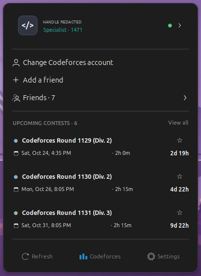
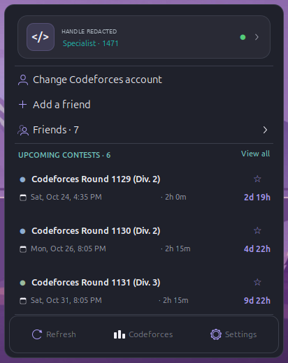
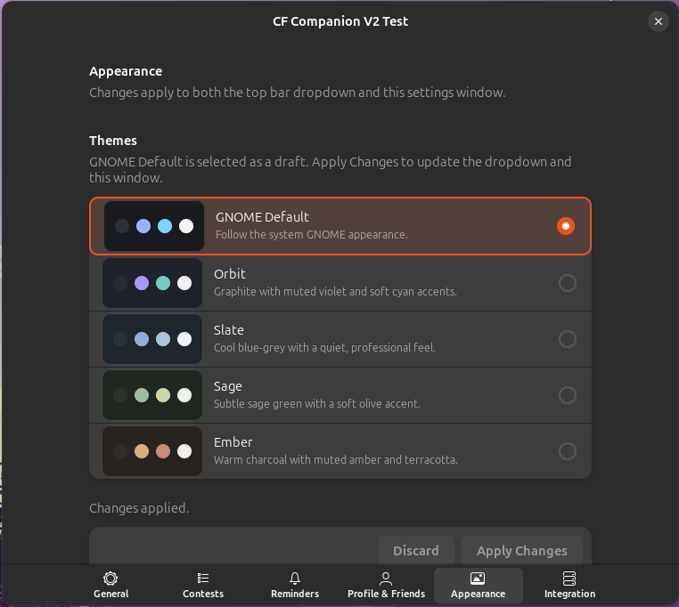

# CF Companion

Follow upcoming Codeforces contests from your GNOME top bar. CF Companion brings contest countdowns, reminders, profile details, and friends into a compact GNOME Shell menu.

[](https://github.com/Tanishgehlot05/cf-companion/releases/latest)
[](https://www.gnome.org/)
[](LICENSE)

CF Companion 2.0.0 is available as a GitHub Release for GNOME Shell 46. GitHub distribution is separate from GNOME Extensions submission and review; this release is not represented as approved by GNOME Extensions.

## Theme Gallery

The screenshots below are captures of the running V2 test extension. The dropdown screenshots have the profile handle redacted.

<table>
  <tr>
    <th align="center">GNOME Default</th>
    <th align="center">Orbit</th>
  </tr>
  <tr>
    <td align="center"><a href="docs/screenshots/v2-dropdown-default.png"></a></td>
    <td align="center"><a href="docs/screenshots/v2-dropdown-orbit.png"></a></td>
  </tr>
</table>

**Appearance settings:** the preferences page with all five implemented palettes.

<a href="docs/screenshots/v2-appearance-settings.png"></a>

## Features

- See upcoming contests, live status, and changing countdowns in the top bar menu.
- Choose contest filters, reminder timing, and panel display preferences.
- Set a Codeforces handle and manage a friends list with rating and rank details.
- Star contests, receive desktop reminders, and use notification actions including snooze.
- Pick from five palettes: **GNOME Default**, **Orbit**, **Slate**, **Sage**, and **Ember**.

## Download and install

Download the production ZIP from the [CF Companion 2.0.0 GitHub Release](https://github.com/Tanishgehlot05/cf-companion/releases/tag/v2.0.0):

[`cf-companion@Tanishgehlot05.github.io.shell-extension.zip`](https://github.com/Tanishgehlot05/cf-companion/releases/download/v2.0.0/cf-companion%40Tanishgehlot05.github.io.shell-extension.zip)

Install the downloaded bundle from a terminal:

```sh
gnome-extensions install ./cf-companion@Tanishgehlot05.github.io.shell-extension.zip
gnome-extensions enable cf-companion@Tanishgehlot05.github.io
```

The extension targets **GNOME Shell 46**. If the extension does not appear in the top bar after enabling it, sign out and back in, then check its state with `gnome-extensions info cf-companion@Tanishgehlot05.github.io`. The GitHub ZIP is a release artifact; GNOME Extensions distribution and approval require a separate submission and review.

## Settings and themes

Preferences let you select contest categories, reminder modes, panel display, a Codeforces profile, and friends. Appearance offers GNOME Default plus four palettes: Orbit (violet), Slate (blue-grey), Sage (green), and Ember (amber). The Telegram control is a placeholder; Telegram integration and its separate backend are not included in this extension release.

## Project documentation

- [Architecture](docs/ARCHITECTURE.md) — runtime modules, settings, and data flow.
- [Development](docs/DEVELOPMENT.md) — local setup, checks, packaging, and troubleshooting.
- [Release guide](docs/RELEASING.md) — version policy and release procedure.
- [Changelog](CHANGELOG.md) — implemented changes and verified release history.

## Links

- [GitHub repository](https://github.com/Tanishgehlot05/cf-companion)
- [GitHub Releases](https://github.com/Tanishgehlot05/cf-companion/releases)
- [GNOME Shell Extensions](https://extensions.gnome.org/) — availability and approval are subject to a separate review.

## License

CF Companion is distributed under the [MIT License](LICENSE). Copyright © Tanishgehlot05.
