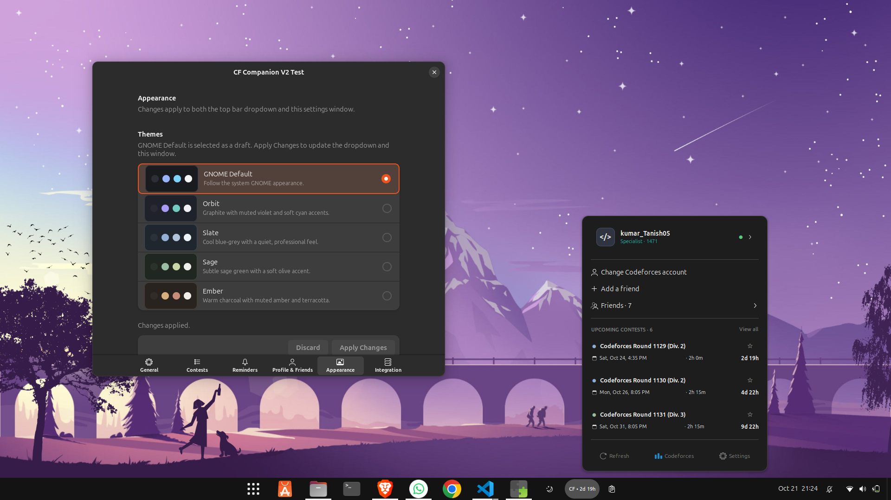
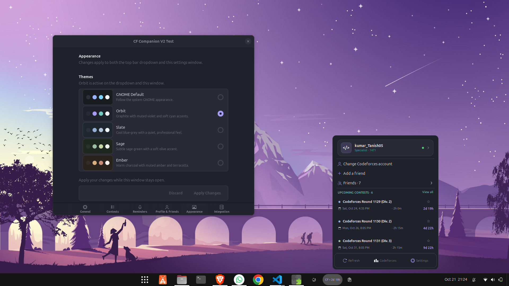
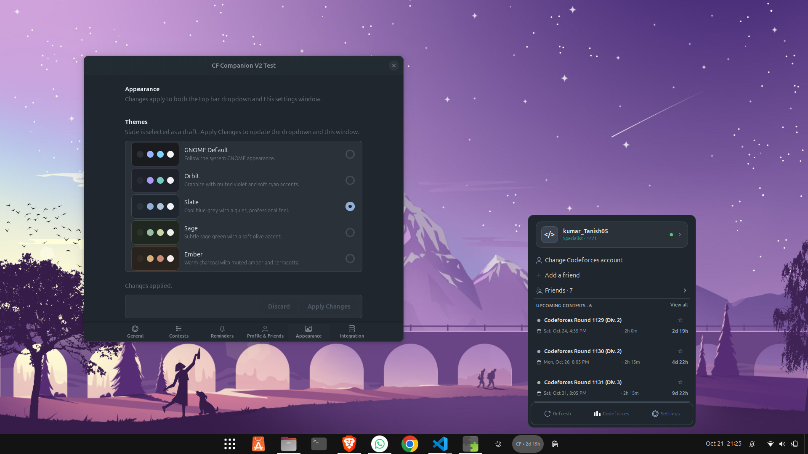
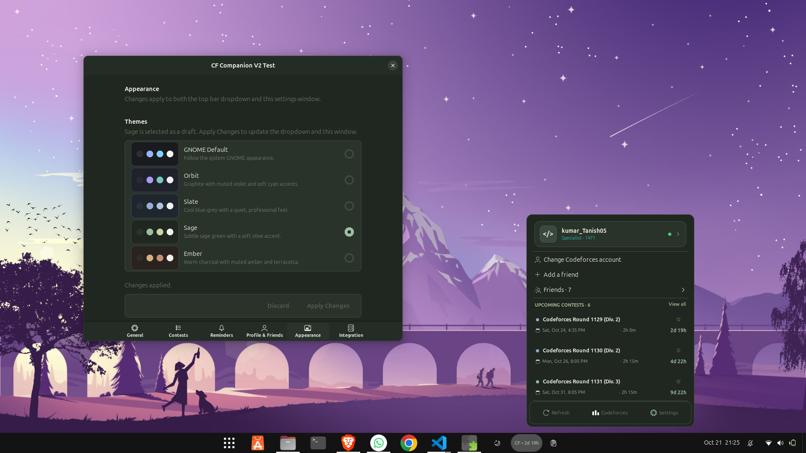
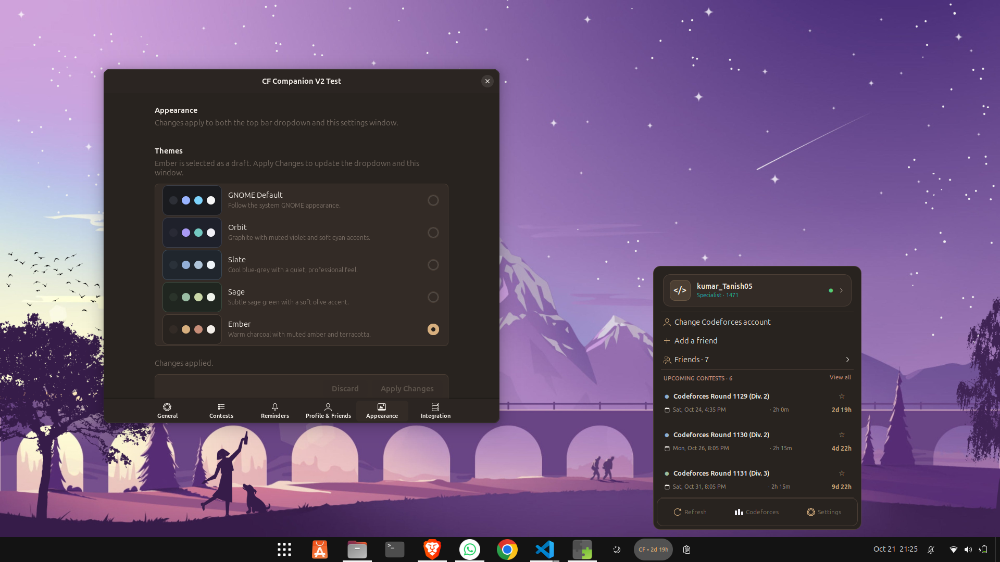

# CF Companion

A GNOME Shell extension that brings Codeforces contests, live countdowns, reminders, and your Codeforces profile to the top bar. Manage friends, star contests, and choose from five themes in a compact dropdown.

[](https://github.com/Tanishgehlot05/cf-companion/releases/latest)
[](https://www.gnome.org/)
[](LICENSE)

## Features

- Track upcoming and live Codeforces contests with countdowns and contest links.
- Get desktop reminders with useful notification actions.
- Manage your Codeforces profile and friends, including rating details.
- Star contests and filter the contest list to your preferences.
- Choose GNOME Default, Orbit, Slate, Sage, or Ember appearance.

## Screenshots

### GNOME Default

[](docs/screenshots/theme-gnome-default.png)

### Orbit

[](docs/screenshots/theme-orbit.png)

### Slate

[](docs/screenshots/theme-slate.png)

### Sage

[](docs/screenshots/theme-sage.png)

### Ember

[](docs/screenshots/theme-ember.png)

## Installation

Download the installable ZIP from the [CF Companion 2.0.0 GitHub Release](https://github.com/Tanishgehlot05/cf-companion/releases/tag/v2.0.0):

[`cf-companion@Tanishgehlot05.github.io.shell-extension.zip`](https://github.com/Tanishgehlot05/cf-companion/releases/download/v2.0.0/cf-companion%40Tanishgehlot05.github.io.shell-extension.zip)

```sh
gnome-extensions install ./cf-companion@Tanishgehlot05.github.io.shell-extension.zip
gnome-extensions enable cf-companion@Tanishgehlot05.github.io
```

Requires **GNOME Shell 46**. This GitHub release is distributed separately from submission and review on GNOME Extensions.

## Links

[GitHub Releases](https://github.com/Tanishgehlot05/cf-companion/releases) · [Report an issue](https://github.com/Tanishgehlot05/cf-companion/issues) · [Development](docs/DEVELOPMENT.md) · [Architecture](docs/ARCHITECTURE.md) · [Release guide](docs/RELEASING.md) · [MIT License](LICENSE)
